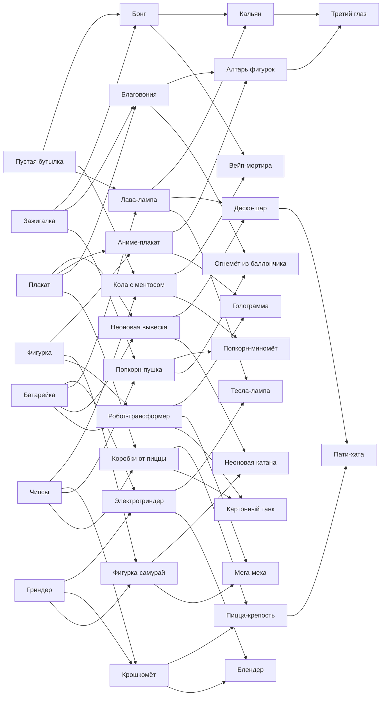

# Предметы и рецепты

Файл собирается из `data/items.json` скриптом `tools/gen_items_doc.py`. Правь json, а не этот файл.

## Как играется

Бесконечный забег. Глюки идут справа волнами, каждая волна сильнее. Вован и Димон с крыльца швыряют на поле хлам из хаты: раз в несколько секунд в свободную клетку левой половины поля падает случайный базовый предмет. Игрок не покупает оборону, а перетаскивает предметы и сливает их друг с другом.

- **Перетащить** предмет на пустую клетку — переставить.
- **Одинаковые** одной звезды — тот же предмет на звезду выше, до ★3. Звезда даёт больше урона, скорости и радиуса.
- **Разные из рецепта** — новый предмет. Звезда результата — меньшая из двух, поэтому выгодно сначала прокачать обе половинки.
- **Несочетаемые** — просто меняются местами.
- **Кубик D20** — редкий джокер: +1 звезда любому предмету, на «критической двадцатке» (1 из 20) сразу +2. D20 на D20 — случайный предмет второго уровня.
- Глюки грызут предметы так же, как раньше грызли оборону. Сгрызенный предмет исчезает.
- **Лампочки** падают с чипсов, с убитых глюков и с неба. На них покупается «Порыться в хате» — ещё один случайный базовый предмет, цена растёт.
- Пылесосы в каждом ряду — последний шанс, как раньше. Глюк дошёл до крыльца — забег окончен.

## Рогалик

- **Волны бесконечны.** С каждой волной глюков больше, они толще и быстрее, в пул добавляются новые виды.
- **Каждые 5 волн — выбор одной из трёх «вписок»** (перков) на весь забег. Например: «Чипсы дают +1 лампочку», «Все дымовые предметы замедляют на 20% сильнее», «Вован швыряет хлам вдвое чаще», «Первое слияние каждой волны даёт +1 звезду», «D20 падает в три раза чаще».
- **Каждые 10 волн — босс:** кракен, Дракула со свитой и т.д.
- **Книга рецептов** открывается между забегами: рецепт виден, только когда его хоть раз собрал. Секретные предметы не подсвечиваются вообще.
- В конце забега — счёт: волна, убитые глюки, лучшие собранные предметы.

## Почему это не цепочка от А до Я

- Каждый базовый предмет входит в 3–4 рецепта. Батарейка и плакат — в четыре, поэтому они самые ценные и самые спорные: куда пустить.
- Каждый предмет второго уровня ведёт в 2–3 разных предмета третьего уровня. Лава-лампа может стать кальяном, диско-шаром или тесла-лампой; робот — мехой, голограммой или танком.
- Роли разные: стрелки, стены, ловушки, ауры, экономика, призыв, массовый контроль. Хорошая оборона — это сочетание, а не один самый сильный предмет. Аура лава-лампы бесполезна без соседей, а голограмма спасает только если рядом есть чем бить.
- Звезда результата — минимальная из двух, поэтому есть выбор: собрать новый предмет сейчас на ★1 или сначала прокачать половинки и получить его сразу на ★2–★3.
- Секреты собираются из двух предметов третьего уровня — это долгая цель на поздние волны.

## Базовые предметы

| Предмет | Из чего | Роль | Что делает | Ведёт в |
|---|---|---|---|---|
| **Зажигалка** | падает на поле | огонь вплотную | Жжёт глюка в соседней клетке справа. | Бонг, Благовония, Попкорн-пушка |
| **Пустая бутылка** | падает на поле | дешёвая преграда | Глюк тратит время, чтобы её разбить. | Бонг, Кола с ментосом, Лава-лампа |
| **Гриндер** | падает на поле | укус вплотную | Кусает глюка в соседней клетке зубьями. | Электрогриндер, Крошкомёт, Фигурка-самурай |
| **Батарейка** | падает на поле | усилитель | Соседние предметы бьют на 25% быстрее. | Электрогриндер, Лава-лампа, Неоновая вывеска, Робот-трансформер |
| **Фигурка** | падает на поле | слабый стрелок | Кидается мелкими деталями по своему ряду. | Аниме-плакат, Фигурка-самурай, Робот-трансформер |
| **Плакат** | падает на поле | ловушка | Липкий скотч: глюк на этой клетке вязнет и замедляется. | Неоновая вывеска, Аниме-плакат, Благовония, Коробки от пиццы |
| **Чипсы** | падает на поле | экономика | Раз в 10 с даёт лампочку. | Кола с ментосом, Крошкомёт, Попкорн-пушка, Коробки от пиццы |
| **Кубик D20** | редкий | джокер | Сам не воюет. Брось на предмет — поднимет звезду. | — |

## Второй уровень

| Предмет | Из чего | Роль | Что делает | Ведёт в |
|---|---|---|---|---|
| **Бонг** | Пустая бутылка + Зажигалка | замедляющий стрелок | Пускает кольца дыма по ряду: урон и замедление на 40%. | Кальян, Вейп-мортира |
| **Кола с ментосом** | Пустая бутылка + Чипсы | мина | Глюк подошёл — взрыв пены по трём клеткам ряда. | Вейп-мортира, Попкорн-миномёт |
| **Электрогриндер** | Гриндер + Батарейка | мясорубка | Бьёт всех глюков в своей и соседней клетке. | Тесла-лампа, Блендер |
| **Крошкомёт** | Гриндер + Чипсы | дробовик | Огромный урон крошками на 2 клетки вперёд. | Пицца-крепость, Блендер |
| **Лава-лампа** | Пустая бутылка + Батарейка | аура скорости | Предметы вокруг бьют на 40% быстрее. | Кальян, Диско-шар, Тесла-лампа |
| **Неоновая вывеска** | Плакат + Батарейка | ослепление | Глюки в ряду бьют вдвое слабее. | Диско-шар, Неоновая катана |
| **Аниме-плакат** | Фигурка + Плакат | оглушение | Раз в 8 с глюки ряда замирают и пялятся 2 с. | Алтарь фигурок, Голограмма |
| **Благовония** | Зажигалка + Плакат | ядовитое облако | Облако 3×3: урон всем внутри каждую секунду. | Алтарь фигурок, Огнемёт из баллончика |
| **Попкорн-пушка** | Зажигалка + Чипсы | веер на 3 ряда | Стреляет попкорном веером: свой ряд и соседние. | Попкорн-миномёт, Огнемёт из баллончика |
| **Фигурка-самурай** | Гриндер + Фигурка | сильный удар вплотную | Рубит первого глюка катаной. | Неоновая катана, Мега-меха |
| **Робот-трансформер** | Фигурка + Батарейка | лазер насквозь | Лазер прошивает весь ряд. | Голограмма, Мега-меха, Картонный танк |
| **Коробки от пиццы** | Плакат + Чипсы | стена | Очень прочная преграда. | Пицца-крепость, Картонный танк |

## Третий уровень

| Предмет | Из чего | Роль | Что делает | Ведёт в |
|---|---|---|---|---|
| **Кальян** | Бонг + Лава-лампа | дымовая завеса | Дым на 3 ряда и 3 клетки: сильное замедление и урон. | Третий глаз |
| **Диско-шар** | Неоновая вывеска + Лава-лампа | глобальная аура | Все глюки на поле медленнее, все предметы быстрее. | Пати-хата |
| **Алтарь фигурок** | Благовония + Аниме-плакат | призыв | Выпускает на поле фигурок-помощников, они идут на глюков. | Третий глаз |
| **Голограмма** | Робот-трансформер + Аниме-плакат | приманка | Глюки ряда идут к голограмме и не трогают остальное. | — |
| **Вейп-мортира** | Бонг + Кола с ментосом | навесной огонь | Кидает облака пара, которые взрываются пеной. | — |
| **Попкорн-миномёт** | Попкорн-пушка + Кола с ментосом | удар по площади | Бьёт по площади 3×3 в любой точке ряда. | — |
| **Огнемёт из баллончика** | Благовония + Попкорн-пушка | конус огня | Конус огня на 3 клетки вперёд. | — |
| **Пицца-крепость** | Коробки от пиццы + Крошкомёт | стена с турелью | Прочная стена, которая отстреливается крошками. | Пати-хата |
| **Тесла-лампа** | Лава-лампа + Электрогриндер | цепная молния | Молния прыгает по пяти глюкам. | — |
| **Неоновая катана** | Фигурка-самурай + Неоновая вывеска | волна на ряд | Раз в 6 с рассекает весь ряд волной. | — |
| **Мега-меха** | Фигурка-самурай + Робот-трансформер | лазер + катана | Лазер по ряду и удар катаной вплотную. | — |
| **Блендер** | Электрогриндер + Крошкомёт | казнь | Затягивает глюка вплотную и перемалывает: обычные — сразу насмерть. | — |
| **Картонный танк** | Коробки от пиццы + Робот-трансформер | таран | Катится по ряду, давит глюков и возвращается. | — |

## Секретные

| Предмет | Из чего | Роль | Что делает | Ведёт в |
|---|---|---|---|---|
| **Третий глаз** | Кальян + Алтарь фигурок | секрет: урон по всему полю | Раз в 10 с глаз смотрит на поле и бьёт всех глюков. | — |
| **Пати-хата** | Диско-шар + Пицца-крепость | секрет: вечеринка | Раз в 20 с включает вечеринку: 8 с все предметы бьют вдвое быстрее. | — |

## Дерево

